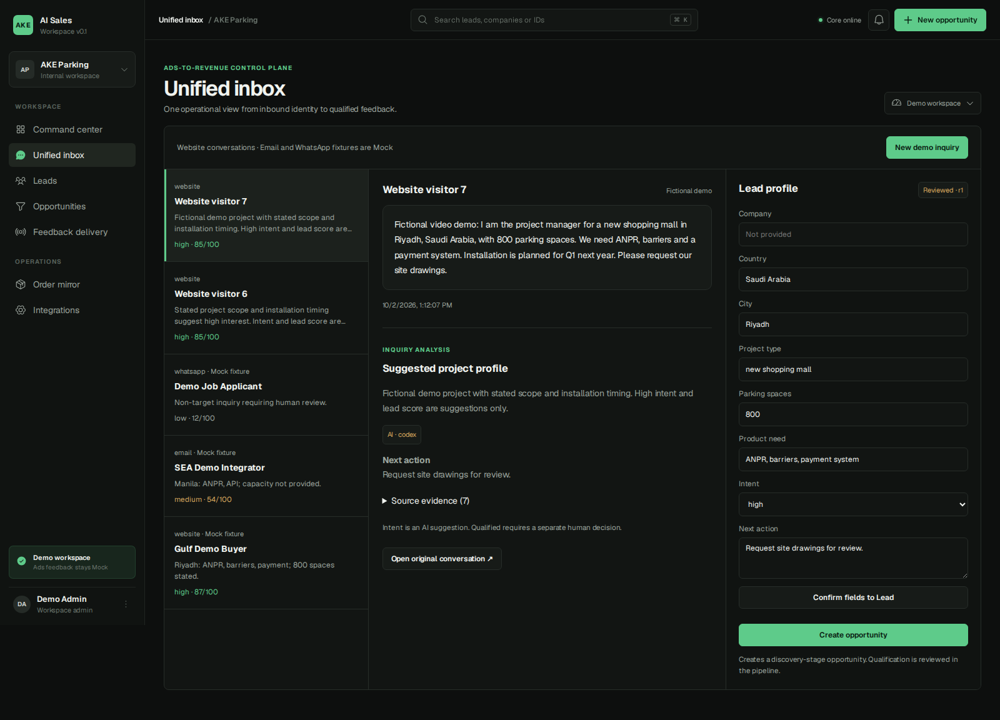
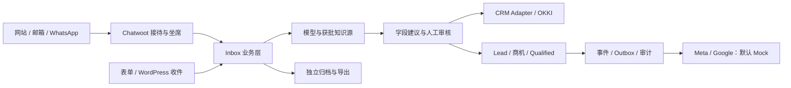

# AKE-Inbox

**面向出海 B2B 团队的自托管询盘与销售协同工作台。**

Self-hosted B2B inquiry operations: connect conversations, reviewed customer requirements, CRM actions and auditable marketing feedback.

[](https://github.com/akeparking/AKE-Inbox/actions/workflows/ci.yml)
[](LICENSE)

[版本与源码下载](https://github.com/akeparking/AKE-Inbox/releases) · [架构](docs/ARCHITECTURE.md) · [功能边界](docs/FEATURE_STATUS.md) · [路线图与竞品](docs/ROADMAP.md) · [贡献](CONTRIBUTING.md) · [安全](SECURITY.md)

> **当前正式版本为 [v0.3.1](https://github.com/akeparking/AKE-Inbox/releases/tag/v0.3.1)。** 修复审查确认的 5 项问题：并发发送连接池等待、来源更正竞态、新旧 Meta 重复回传、旧回执处理和同意升级上下文。广告保持 Mock；从 v0.3.0 升级无需新增数据库迁移。验证与部署边界见[发布报告](docs/RELEASE_REPORT_v0.3.1.md)。

## 解决什么问题

制造业、设备、工程和外贸团队的采购需求往往分散在 WhatsApp、邮箱和网站中。销售需要理解项目、记录规格、确认下一步；运营需要知道哪些询盘真正有效。AKE-Inbox 把这些环节关联起来，目标是减少漏跟、重复录入和无法解释的线索判断。

一条典型路径：

**接收询盘 → 保留原始证据 → AI 提取需求 → 人工确认 → 线索/客户/商机 → 跟进与阶段 → 可核对的回传记录。**

初始场景使用停车设备项目演示，但业务层按 B2B 长周期采购设计：公司、联系人、询盘和商机应分别建模；同一联系人不等于同一公司，一家公司也可能有多个项目。完整公司级自有 CRM 仍在路线图中。

## 当前源码包含的功能

新增本地增量：[Meta Ads 回传](docs/META_ADS_FEEDBACK.md)。支持管理员准备阶段事件、一键直连 CAPI、持久回执和防重复发送；默认 Mock，启用正式发送与停止旧 OKKI 网关仍需完成各自的实际验收。

| 模块 | 功能与作用 | 当前边界 |
|---|---|---|
| 统一接待 | Chatwoot 网站/邮箱接入、坐席路由、会话状态、人工接管 | 需要独立配置渠道；支持范围取决于所用 Chatwoot 版本 |
| WhatsApp 适配 | WAHA 接入保护、附件与消息回执、发送权控制；保留旧 Evolution 适配 | 不附带号码或登录会话；真实收发、重连和升级需独立验收 |
| AI 需求辅助 | 项目字段、意向建议、摘要与原文证据；人工确认后写入 | 默认 Mock；知识库和模型凭据不随源码分发 |
| 接待自动化 | 接管/恢复、退订/屏蔽、取消待执行任务、受控跟进 | 外发默认关闭；时区未知转内部提醒；商业承诺需人工 |
| CRM 工作流 | Lead、商机 Kanban、阶段版本检查、人工 Qualified、审计与幂等事件 | 演示级销售流程，非完整 ERP 或成熟多租户 CRM |
| OKKI 连接器 | 读取字段/枚举、关联档案、受控线索/客户/跟进/商机写入和回读 | 写入默认关闭；需账户权限和租户映射；完整双向同步尚未交付 |
| 网站询盘与归因 | 同意状态、访客/访次/来源、表单收件、WordPress 持久投递与重试 | 不将点击等同有效询盘；实际网站 CMP/缓存配置需验收 |
| 转化账本 | 区分校验、受理、处理、匹配；Meta/Google 适配与防重逻辑 | 默认 Mock；真实平台接入、匹配和广告效果不作完成声明 |
| 归档与导出 | 消息版本、原始邮件/附件映射、PDF/CSV/XLSX/ZIP、SHA-256、权限检查 | 原始文件不随源码提供；缺失证据不会伪装成完整导出 |
| 运维与验证 | 数据库迁移、备份脚本、隔离测试、CI、公开源码检查 | 单实例/低并发起点；高可用与规模化运营待建设 |



图片来自项目早期演示，全部为虚构测试场景；不是当前生产部署或本版本全量功能的截图。详见[功能与验证分级](docs/FEATURE_STATUS.md)。

## 快速开始：不需要任何真实账号或密钥

使用 Linux / WSL2、Node.js **24+** 和 npm。安装依赖需要联网。

```bash
git clone https://github.com/akeparking/AKE-Inbox.git
cd AKE-Inbox
npm ci
npm run build -w @ake/contracts
npm test
npm run dev:api
```

另开终端，在同一仓库运行：

```bash
npm run dev
```

打开 `http://127.0.0.1:3000/workspace`，使用 **Unified inbox → New demo inquiry** 体验询盘、审核、商机与 Mock 回执。默认内存存储，重启后数据重置。不要把开发服务器暴露到公网。

此路径演示 Revenue Core 与销售工作台；完整 `/inbox` 坐席界面需要 Chatwoot 登录与服务配置。演示无需复制 `.env.example`；该文件是完整 Compose 部署的变量清单，应用不会自动把它当成开发配置加载。

### 完整 Inbox 和持久化部署

1. 准备独立 PostgreSQL、Redis、Chatwoot 和私有环境配置；先备份已有数据库、配置和归档。
2. 使用 [Inbox v0.2 部署说明](docs/INBOX_V0.2_RELEASE.md)、[渠道说明](docs/INBOX_CHANNELS.md) 与 [本地营销环境说明](deploy/marketing/README.md) 选择所需模块。
3. `npm run build` 后设置私有 `DATABASE_URL`，运行 `npm run migrate`。当前包含 `001`–`006` 迁移。
4. 配置自己的 API/session/encryption secrets、账号编号、渠道映射与 OKKI 枚举；真实凭据只存在私有环境中。
5. 保持 `ADS_MODE=mock`、`INBOX_AUTO_SEND=false`、`OKKI_WRITE_ENABLED=false`，完成权限、重复事件、重启恢复及实际渠道回读验收后再逐项启用。

`deploy/marketing/bootstrap-local.mjs` 可以创建全新的隔离测试环境，细节见该目录 README。它不复制生产数据库、WordPress 内容或 WhatsApp 会话；部分扩展依赖本地预备镜像，完整栈目前还不是任意机器一条命令即可部署的产品。

## 架构与扩展接口



Chatwoot 保存消息与坐席状态，自有业务层保存需求、身份映射、业务事件和审计；外部 CRM 的权威字段需要明确映射。未知值留空，明确的零保留；字段确认、创建商机和确认 Qualified 是不同操作。

| 路径 | 作用 |
|---|---|
| `apps/workspace-web` | Next.js 工作台、登录和受限后端代理 |
| `apps/revenue-core` | NestJS API、Inbox、营销、CRM、worker 与 PostgreSQL |
| `apps/requirement-engine` | 可选知识检索与需求分析；私有知识资料不内置 |
| `packages/contracts` | 共享结构、校验与虚构 fixtures |
| `deploy/demo/archive` | Chatwoot 扩展、坐席、归档和原生界面挂载 |
| `deploy/marketing` | 网站采集、WordPress、WAHA 保护与本地环境 |
| `supplemental/google-offline` | 可选单事件验收工具；显式配置才能执行真实请求 |
| `test` / `scripts` | 渠道、权限、可靠性和浏览器验证 |

## 借鉴和依赖了哪些项目

- **[Chatwoot](https://github.com/chatwoot/chatwoot)**：实际集成的消息、收件箱和坐席基础。仓库保存 AKE 扩展及部署配置，没有内置 Chatwoot 全量源码。社区代码与企业目录的许可分开，详见[上游许可证](https://github.com/chatwoot/chatwoot/blob/develop/LICENSE)。
- **[WAHA](https://github.com/devlikeapro/waha)**：WhatsApp HTTP 服务与 Chatwoot App 集成路线；本项目在发送、权限、归档和回执周围增加业务保护。WAHA WEBJS 引擎基于 [whatsapp-web.js](https://github.com/wwebjs/whatsapp-web.js)，不是本项目另造一套 WhatsApp 协议实现。
- **[Evolution API](https://github.com/EvolutionAPI/evolution-api)**：保留早期桥接适配，供迁移与回滚使用；不能让两套桥同时对同一号码发送。
- **[AKE Revenue Intelligence](https://github.com/akeparking/ake-revenue-intelligence)**：同一维护者的前序询盘到收入演示，提供 Lead、商机、人工资格确认、事件/Outbox 等基础。此仓库从包含未提交变更的完整源码快照整理发布，未导入未经本次审查的旧 Git 历史。
- **Next.js / React、NestJS、PostgreSQL、Redis/BullMQ、Zod、PDFKit**：界面、API、持久化、队列、校验与导出基础。依赖版本见锁文件，许可归各自项目。

Kommo、respond.io、OKKI 是产品与流程参照或集成对象，不是复制其专有源码的来源；未宣称官方合作、兼容认证或功能完全等同。[第三方说明](THIRD_PARTY_NOTICES.md)列出各自边界。

## To B 定位与竞品参照

这里的 Kommo 对应研究材料中的消息型 CRM（原需求写作“Koama”）。以下是产品方向比较，不是全功能或性能测评。

| 参照 | 官方公开方向 | AKE-Inbox 的学习重点与差距 |
|---|---|---|
| [Kommo](https://www.kommo.com/product-overview/) | 消息型 CRM、销售管道、AI 与自动化 | 学习会话到销售阶段的连接；公司/多项目关系、活动和权限仍需深化 |
| [respond.io](https://respond.io/help/quick-start/what-is-respondio) | 多渠道会话、AI、自动化和 CRM 集成；[与 CRM 协同](https://respond.io/faqs/is-respondio-a-crm-replacement-or-does-it-work-alongside-it) | 学习接待效率、路由和可靠性；AKE 的方向是设备/工程外贸的长周期 B2B 询盘 |
| [OKKI CRM](https://open.xiaoman.cn/) | 客户、联系人、线索、商机等业务及开放接口 | 先可靠对接现有 CRM；以项目证据决定是否建设薄型自有 CRM |

价值假设是“更少漏跟、更少重复录入、更清楚的采购资格与下一步”。尚无外部付费试点或增收、降本结果可以作为既定成果。推荐追踪漏跟率、合格询盘处理时间、重复档案率、AI 错筛率、未解决同步失败、客户上线工时。

## 未完成功能与扩展方向

- 官方 WhatsApp Cloud API 产品化通道，以及模板、服务窗口、重连和受控切换的完整验收。
- OKKI 双向增量同步、负责人/阶段/输赢/金额回流、定期对账及冲突处理；真实客户更新与全流程商机验收。
- 企业级公司—联系人—多个询盘/商机关系、报价版本、采购角色、活动与下一次跟进；租户自己的 L1–L4 规则仍需映射。
- 多租户隔离、细粒度权限、SSO、数据保留/删除、可观察性、备份恢复演练与高可用。
- 通用模型/BYOK 配置、获批知识版本管理、引用覆盖评估和多语言质量；不把 AI 建议当已确认事实。
- 真实广告回传与匹配验收、网站 CMP/缓存实际部署、可归因业务结果评估；保持网站/表单/CTWA 等来源分离。
- 可复现的完整安装包和外部付费试点；再依据真实需求扩展薄型自有 CRM。ERP、财务、库存和全渠道群发不属于本版已交付能力。

[路线图](docs/ROADMAP.md)描述阶段门槛。它是规划，不是发布日期或商业效果承诺。

## 测试与开源协作

```bash
npm test
npm run test:channels
npm run test:google-guards
npm run typecheck
npm run build
npm run check:public
npm audit --audit-level=high
```

`npm test` 默认运行内存与 Mock 用例；设置独立的 `TEST_DATABASE_URL`、`INBOX_TEST_DATABASE_URL`、`MARKETING_TEST_DATABASE_URL` 后可运行 PostgreSQL 持久化/并发用例。必须使用独立测试库，先迁移 sales/marketing 库；CI 自动准备这三个数据库。浏览器脚本、原生 Chatwoot、WordPress 和真实渠道另有环境要求，不能把未运行的检查计为通过。

参见 [v0.2.0 发布检查](docs/PUBLIC_RELEASE_AUDIT.md)、[贡献规范](CONTRIBUTING.md)、[行为准则](CODE_OF_CONDUCT.md) 和 [安全披露](SECURITY.md)。Issue、日志和截图须使用虚构数据；请勿提交 `.env`、密钥、客户消息、数据库或 provider session。

## 版本与旧源码保留

每次正式发布使用新的 `vX.Y.Z` 标签和 GitHub Release，并提供完整源码 ZIP/TAR.GZ 与 SHA-256。**不覆盖、不移动、不删除旧版本标签和源码包**；修复通过新版本发布。`main` 是持续开发分支，安装时优先选择标签。[版本策略](docs/VERSIONING.md)说明升级、回滚和安全事件例外。

本次首个公开版本为 [v0.2.0](https://github.com/akeparking/AKE-Inbox/releases/tag/v0.2.0)；不能把源快照未包含的旧版本历史伪造为本仓库已发布版本。

## License

AKE 自有代码沿用 [MIT License](LICENSE)。依赖、外部服务、字体、商标和 Chatwoot 企业组件各有独立条款；本仓库许可证不替代其许可。使用与贡献前请阅读 [THIRD_PARTY_NOTICES.md](THIRD_PARTY_NOTICES.md)。
