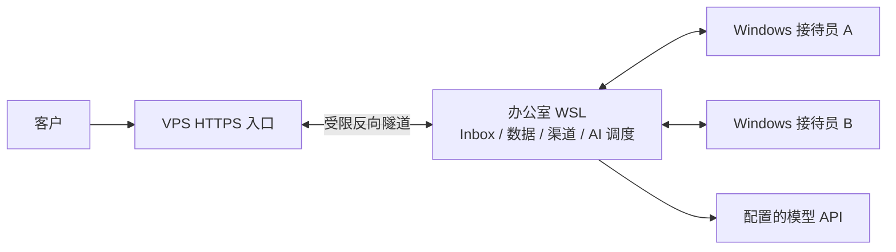

# Windows 接待工作台与办公室 WSL 主机

接待员使用 Windows APP，本机 WSL 常开运行 Inbox、数据库、附件、渠道连接和 AI 调度。VPS 通过办公室主动建立的 SSH 隧道转发 HTTPS 与 WebSocket 请求。AI 使用公司提供的 API Key、Base URL 与模型名，不使用浏览器账号或 Codex 登录。

## 接待规则

1. 账号须已确认、有该 Inbox 权限、接待状态在线，并在最近 75 秒内有有效心跳。客户端每 20 秒续约。同一人的多个客户端算一个席位，管理员不占用公用接待轮次；已经明确设为通道接待人的管理员，可以接待自己负责的邮箱或 WhatsApp。
2. 新会话按在线人员轮询；原接待员仍在线时保留归属。离线后，有其他在线成员则转接，全员离线则 AI 接待。
3. 人工上线时重新分配开放的受管会话、更新版本并取消旧 AI 任务。生成完成、发送入队及渠道投递前均复核，阻止迟到的 AI 回复。
4. 人工暂停、明确要求人工、退订、屏蔽和已解决状态继续生效。模型未配置、调用失败或需人工确认时进入待处理状态，不伪造回复。
5. 切换 APP 工作区时接待视图继续续约；关闭窗口保留托盘，仍可接待。离席请点击接待台的“下线”，或从托盘退出。退出、睡眠和断网后，心跳租约到期即失去在线资格。

租约由共享 Redis 保存；轮询游标存数据库；分配与最终发送使用账户锁和会话版本。客户端仅报告在线状态，不独立分单或直接调用渠道。

## 数据与断线行为

- 本机为切流后的唯一业务写入点。切流前冻结 VPS Inbox，复制最终数据库、附件、归档和 WhatsApp 回执，校验后切换；旧应用不能同时消费。
- 已进入本机 Inbox 的消息存 PostgreSQL，签名回调失败进入 Sidekiq 重试；Core 按事件去重，发送队列带版本和回执。渠道结果不确定时进入核查，不盲重发。
- VPS 是固定反向代理，**没有离线消息暂存队列**。整台办公室主机断网、关机或睡眠时，新请求返回 503，客户端须保留未发送内容并重试，AI 暂停。隧道恢复会自动重连。
- 邮件与 WhatsApp 在办公室连接各自渠道；离线补取能力受渠道本身限制，不能保证未被渠道保留的消息可恢复。
- 附件、数据库和缓存都在 WSL ext4。Windows 存客户端和交付文件。保留最终迁移快照及旧主机回滚副本，正式备份应复制到独立存储。

## API 模型

受限适配器读取本机 `private/reception-config.json` 的 `model_api`：`base_url`、`model`、`api_key`。密钥文件权限 600，只由本机服务用户读取；不进入 APP、源码或 VPS 中转配置。

适配器使用 OpenAI 兼容 `/chat/completions`，禁止重定向携带凭据、限制超时与响应大小、验证完整 JSON 结构并拒绝工具调用和截断回复。客户消息作为不可信数据；只允许引用已审核知识。商业承诺、未覆盖的产品问题与证据不足的字段交给人工。Core 决定是否允许发送。

`/health` 提供配置是否就绪、调用状态及接口返回的模型标识，不返回 Key。网关别名与实际回传模型可能不同；回传标识只能证明网关声明，不能独立认证底层权重。

## 部署与恢复

- `deploy/office/compose.yaml`：独立本机运行，默认只读预备环境；`delivery` 启动后台队列，`channels` 启动 WhatsApp。
- `deploy/office/live.yaml`：在最终迁移和登录重置后授予渠道服务外网访问。数据库与 Redis 不暴露公网。
- `deploy/relay/proxy.mjs`：只转发配置的两个主机，禁止公网访问内部接待路由。
- 本机 model/tunnel 服务由 systemd 管理；隧道账户只可监听指定的两个回传端口，不能执行 Shell 或开其他转发端口。
- Windows 登录时启动 WSL 保活任务；接通电源时禁用自动睡眠，电池设置不变。重启后需要完成 Windows 登录。此轮未执行整机重启，因此完整开机恢复仍需一次维护窗口验收。

## 验收边界

已完成 Windows x64 实际 EXE 登录、心跳、工作区切换后续约及远程页面隔离；真实消息回调验证双席位轮询、权限排除、原归属保持和退出后租约过期。

真实公司 API 已验证：全员离线回复进入原生 Inbox，生成期间人工上线取消待发回复。另用明确标注的模拟模型验证重复事件只发一次、Core 中断后队列重放、延迟回复取消及失败转人工。模拟结果不作为模型能力证明。

切流记录、实际部署地址、模型回传标识、数据数量及尚待重新绑定的账号，以部署主机生成的验收记录为准。尚未验证多台实体 Windows 电脑、整机重启、真实邮件收发和 WhatsApp 扫码后的端到端渠道收发。

参考：[Electron 安全指南](https://www.electronjs.org/docs/latest/tutorial/security)、[WSL systemd 说明](https://devblogs.microsoft.com/commandline/systemd-support-is-now-available-in-wsl/)。
